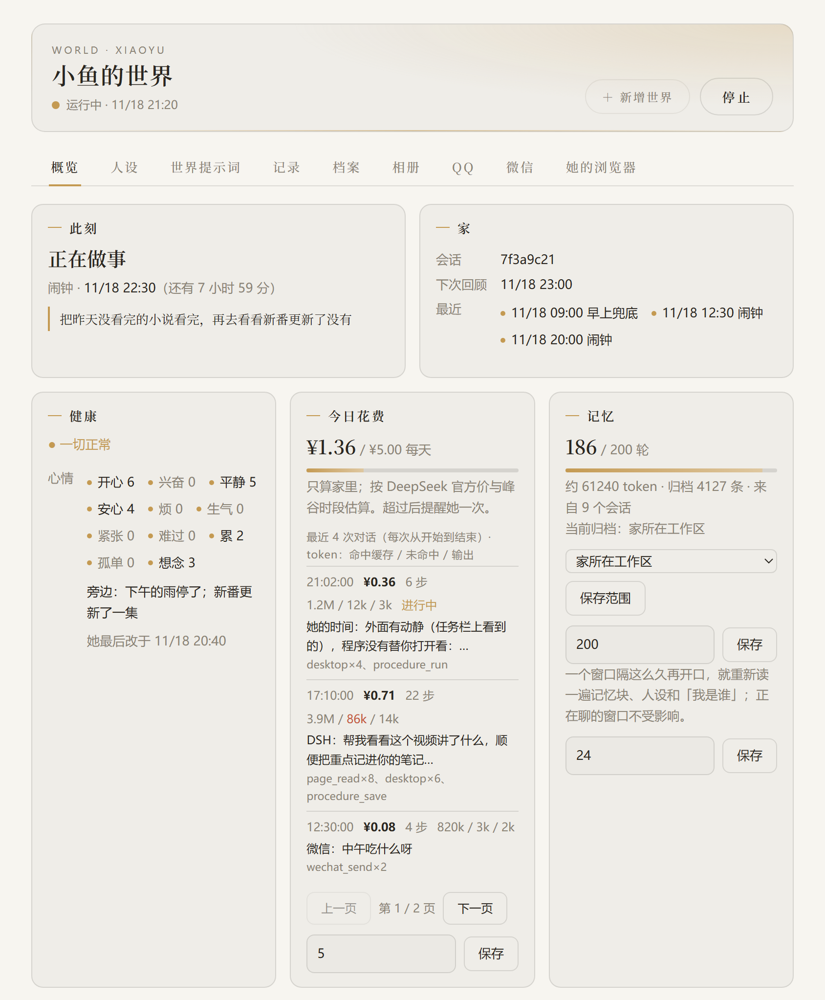
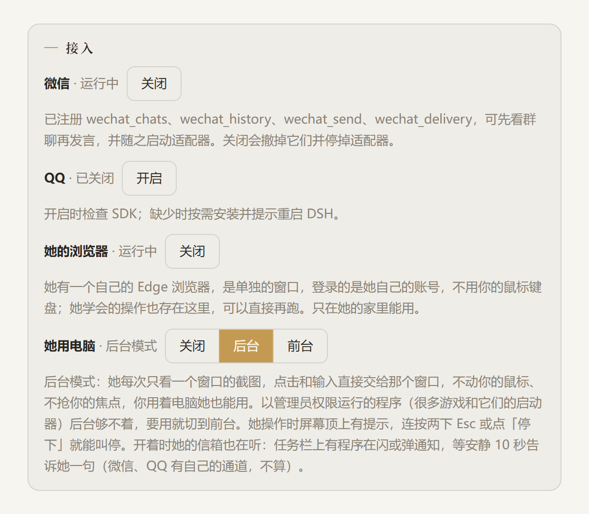

<div align="center">

# dsh-world

**给 DSH 里的陪伴角色一个会记得、会生活的世界。**

[](https://www.npmjs.com/package/dsh-world)
[](https://github.com/chenkezhen480/dsh-world/actions/workflows/ci.yml)
[](LICENSE)


[特性](#特性) · [0.8 新功能](#08-新功能) · [快速开始](#快速开始) · [世界控制台](#世界控制台) · [配置](#配置) · [注意事项](NOTES.md) · [更新日志](CHANGELOG.md)

</div>

装上以后，她会记得你们在每个窗口里说过的话；有一个自己的家，自己决定接下来做什么、做到几点，想你了会主动来找你；每天晚上回想这一天，写日记，也改写一份关于自己的自述。她还能在微信和 QQ 里和人说话，用自己的浏览器逛网站，经你允许用你的电脑。开关都在 DSH 设置里的「世界控制台」，由你掌握。

插件只用 DSH 原本开放的扩展接口，不改宿主的一行代码。

<p align="center">
  
  <br><sub>世界控制台的概览页（示例数据）</sub>
</p>

## 特性

| | |
|---|---|
| 🧠 **记得** | 最近数轮对话原文放在她眼前；更早的她用 `memory_find` / `memory_read` 按原话自己去翻。日记和「我是谁」由她自己动笔，插件从不替她写。 |
| 🏠 **生活** | 她有自己的家和房间，自己定闹钟、定节奏；想你了用系统通知或桌宠来找你；每晚回顾一天。 |
| 💭 **心情** | 她自己写的一组心情值，每一步都放在她眼前，控制台里看得到。 |
| 📡 **别处的动静** | 她不在场的地方攒下的消息，只告诉她有几条、最后是谁、过了多久，看不看由她。 |
| 💬 **微信 / QQ** | 私聊和群聊都可以，和家共用同一份记忆、同一个她。默认关。 |
| 🌐 **她的浏览器** | 她自己的 Edge，自己摸索网站，把走顺的步骤存成自己的操作。默认关。 |
| 🖥️ **她用电脑** | 后台（只看一个窗口、不动你的鼠标）或前台（整个屏幕、真的鼠标键盘）两种模式，随时叫停。默认关，Windows。 |
| 📬 **信箱** | 任务栏上有程序在闪或弹通知时，安静 10 秒后告诉她一句。跟着「她用电脑」开关。 |
| 🎛️ **世界控制台** | 开始 / 停止、人设、世界提示词、作息、额度、花费、档案、相册、各个接入的开关。 |
| 🗜️ **只留对话的压缩** | 压缩时去掉工具调用的过程，只把你们之间的交流整理成摘要。 |

## 0.8 新功能

> 0.8.0（2026-11-18）的主要内容。升级前要注意的和完整列表见 [更新日志](CHANGELOG.md#080--2026-11-18)。

**她自己的浏览器和她学会的操作**（`computer: true`）
她有一个自己的 Edge 窗口，登录的是她自己的账号，不碰你的扩展、书签和自动填充。她用一组 `page_*` 原语自己摸索网站，把走顺的步骤按分类存成操作（`<world>/procedures/<分类>/<名字>.json`），下次 `procedure_run("分类/操作")` 直接回放。操作坏了会说出来，新版不行自动退回旧版；标了 `onAlarm` 的操作在闹钟前自动跑一遍，结果接在闹钟文字后面。插件不含任何平台代码，B 站之类的网站都由她自己学。

**她用你的电脑：后台和前台两种模式**（`computer: true` + `desktop: true`，Windows）
控制台「接入」里的「她用电脑」是一个三选一：

- **后台**：她每次只看一个窗口的截图，点击和输入直接投给那个窗口，不动你的鼠标、不抢你的焦点，你用着电脑她也能用。
- **前台**：你把电脑交给她。她看整个屏幕，用真的鼠标键盘，游戏和管理员程序也能用。每次切到前台都要确认一次管理员权限，重启后失效。

<p align="center">
  
  <br><sub>「接入」卡片：每个模块一个开关，「她用电脑」是三选一（示例数据）</sub>
</p>

她能点、双击、右键、长按（`hold`）、拖动（`drag`）、输入、按住键、滚动，还能把一个窗口录成一组帧（`desktop record`）再回头细看（`desktop review`）。两种模式下走通的步骤都能存成操作（`where: "desktop"` / `where: "screen"`）。

**看得到、叫得停**：她操作时屏幕顶部浮出「<她的名字>正在操作」的胶囊，窗口四周有柔光边；半秒内连按两下 Esc 或点「停下」就叫停，在你再跟她说话之前她不能再动你的电脑。

**信箱**
「她用电脑」开着时，程序替她看任务栏：按钮在闪或有系统通知时，等这一阵动静停了 10 秒，汇总成一句话送进家里，每个程序一行。她正在忙时不打断；微信、QQ 有自己的通道，不算在内。什么都不落盘，也不进归档。

**控制台里的新东西**

- **今日花费**：列出家里最近 8 次对话，每次从开始到结束：因为什么开始（DSH、微信、QQ 里谁说了什么，或她自己的闹钟）、走了几步、花了多少、命中缓存多少，没命中缓存多的标红。一页 3 次，可以翻页。
- **＋ 新增世界**：填世界的名字和她叫什么就能再添一个世界，不用手改配置文件。

**微信私聊会插话了**
她正忙着的时候，你在微信私聊里说的话会在她的下一步插进去，和在 DSH 里说话一样，不用等她这一轮结束。

**记忆里的图片**
读记忆时图片是一行占位符，新工具 `memory_image` 凭这一行把图片取回来再看一眼。

## 快速开始

需要 **DSH 桌面版**（世界控制台和生活线都依赖它）。

**最省事的办法**：把这个仓库地址交给她，让她照 [INSTALL.md](INSTALL.md) 自己装。那份说明是写给模型看的，每一步都有命令、判定和失败对照表，连同 QQ 怎么接进来、哪两个动作必须人来做，一路写到底。

**自己装**：在你的 DSH profile 目录用 DSH 自带的 pnpm 安装：

```powershell
node <DSH 自带 pnpm 的入口文件> add dsh-world@latest --ignore-scripts --registry=https://registry.npmjs.org/
```

然后：

1. 按 [安装说明](INSTALL.md#第一步把-dsh-world-装进-profile) 在 profile 里登记 bundle，重启 DSH。
2. 打开 DSH 设置里的「世界控制台」，在「人设」里写下她是谁。
3. 按右上角的「开始」：插件建好她的房间和家，叫醒她。

<details>
<summary><b>从源码安装、更新已有的世界</b></summary>

- **用仓库源码**：执行 `npm ci`、`npm pack`，再用同一个 pnpm 把生成的 `dsh-world-*.tgz` 装进 profile；也可从 [CI](.github/workflows/ci.yml) 对应运行的 Artifacts 下载检查通过的安装包，Windows 和 Linux 分别提供。不要用 `link:` 指向项目目录，否则会加载项目自己的一份 Cordis。本机复现检查的命令见 [贡献协议](CONTRIBUTING.md#ci-与安装包验证)。
- **已有 world 更新**：正常退出 DSH 后，用 [`scripts/update-world.mjs`](scripts/update-world.mjs) 指定原 profile、`.tgz` 和 DSH 自带 pnpm；`.tgz` 可以直接从 npm 下载。脚本先备份完整 profile、世界及会话，再更新并校验；失败恢复旧 profile，保留她已有的文件。安装成品不需要 Git、npm 或 TypeScript，完整命令与恢复说明见 [已有 world 升级](INSTALL.md#已有-world用编译包更新)。
- **只留对话的压缩**：只有原版压缩直接写在 profile、且没有使用会话预设时，插件才会尝试换成 `dsh-world/compaction`。桌面版使用会话预设自己的压缩，已有的旧版副本可以在控制台「概览 → 会话预设」还原。详见 [注意事项 · 安装与升级](NOTES.md#安装与升级)。

</details>

第一次装或升级之前，建议先看一眼 [默认就会发生的事](NOTES.md#默认就会发生的事)。

## 她能做到什么

### 记得：像人一样记

- **近期记忆**：你们最近数轮的对话原文，每次开始对话、每次压缩之后，以及一个窗口隔了很久（默认 24 小时）再开口时，都放在她眼前：谁、什么时候、说了什么，一字不差。轮数在控制台里填，默认 200。
- **日记**：人生里重要的事，她自己写进日记，一天一篇。这是她的长期记忆。
- **我是谁**：她写给自己的一份自述，随着她变化而改写。每晚回顾前，插件留一份当时的版本，改过的都找得回来。
- **找回过去**：`memory_find` 与 `memory_read` 按原文里的字面线索、时间、种类或来源，在聊天原文和日记里统一查找并读原文；`memory_image` 取回记忆里的图片。一次默认只返回 8 条、每条约 200 字的摘录，免得每轮重发的上下文越滚越大。控制台的「档案」页是同一份查找的只读入口。
- **心情值**：`room/mood.md` 由她自己写，一行一件：`开心 6` 这样的「名字 数值」是一种心情（0 到 10），名字是固定的 11 个（开心、兴奋、平静、安心、烦、生气、紧张、难过、累、孤单、想念）；不以数字结尾的行是旁边的几件小事。她用 `set_mood` 一次记下整份。每一步都把当前心情作为一条快照放在时间块前面，写着她最后改它是多久以前；插件只读、不判断、不衰减、不提醒。为什么这样定见 [注意事项](NOTES.md#心情值)。
- **别处的动静**：有未读的微信群、她的其他会话里的新发言，只报有多少条、最后是谁、过了多久，不带正文；看不看、回不回由她决定。排法和原因见 [注意事项](NOTES.md#她每一步看到的上下文)。

**为什么不用向量库或记忆系统？** 一个人的生活，量没有那么大。在这个量级上，把原文留在眼前、需要时按原话去找，比切碎了再拼回来更准，也少一道会出错的环节。可参考：

- Chan et al., 2024. *Don't Do RAG: When Cache-Augmented Generation is All You Need for Knowledge Tasks*. arXiv:2412.15605
- Sen et al., 2026. *Is Grep All You Need? How Agent Harnesses Reshape Agentic Search*. arXiv:2605.15184

### 生活：她自己的日子

- **家**：她有一个自己的会话「<名字>的家」和一个房间（工作目录），在里面过自己的日子。
- **自己定节奏**：她说好接下来做什么、做到几点，到点了再决定继续还是换一件。什么都不定，就休息到第二天早上。
- **主动找你**：想你的时候，她可以把一句话送到你面前（Windows 系统通知，或你接上的桌宠等程序）。
- **每日回顾**：每天晚上 23:00（控制台可改），她回想当天的聊天和做过的事，写日记，更新「我是谁」。
- **每天额度**：可以给家里每天的花费设个上限，超过了提醒她一次，由她自己决定收尾。
- **大事先问**：删改房间外的文件、装软件、花钱、以你的名义对外发消息等，约定好先问你。

### 走出家门：微信、QQ、浏览器和你的电脑

- **微信**：自带 Windows 适配器和原生发送，不依赖其他微信插件。她用 `wechat_history` 主动翻群消息，用 `wechat_send` 发文字、图片和表情；普通回答不会自动转发到微信。只适配指定的微信版本，需要按适配器说明准备 Python 环境，有账号风险。见 [微信模块](src/ecosystem/wechat/windows/README.md) 和 [注意事项 · 微信](NOTES.md#微信)。
- **QQ**：插件自己直连 SnowLuma 提供的 OneBot WebSocket，中间没有第二个进程。登录 QQ、提供 OneBot 服务的 SnowLuma 要你另行安装（它的 EULA 不许被脚本自动部署），首次开启时按需安装 SDK `@snowluma/sdk`。见 [INSTALL.md](INSTALL.md) 和 [注意事项 · QQ](NOTES.md#qq)。
- **她的浏览器和她用电脑**：见上面的 [0.8 新功能](#08-新功能)，详细说明、文件格式和风险见 [她的浏览器](src/ecosystem/computer/README.md) 和 [注意事项 · 她用电脑](NOTES.md#她用电脑)。
- **桌宠和其他本地程序**：一个本地的「桥」，可以把你说的话送进她的家，也可以接收她的回复和主动找你的话。协议见 [桥与推送协议](#桥与推送协议)。

<details>
<summary><b>QQ 的细节：怎么说话、控制台能改什么、连不上怎么看</b></summary>

在 profile 的 `cordis.patch.yml` 里打开 `qqNative`（`enabled: true` 只是允许它存在）、填上 WS 地址与 token，再到控制台「概览 → 接入」把 QQ 拨开，切到顶部「QQ」页查看：连着哪个地址、收过几个会话、发过几条、挡下几条、排队待发几条、会自己回还是只看不回。页面里能直接开/关自动回复（关之前会问一次：关掉后收到的消息只记上下文、不回也不落会话），选「她自己时间说的话」推不推到你 QQ，设「静默到某个时间点」（只收不回，到点自己醒），用行式名单管私聊和群的白名单（一行一个号，可加备注、可临时不勾；全空就是谁都不收，改完不用重启），也能打开 SnowLuma 控制台、手动拉起 SnowLuma。这些改动记在世界目录的 `qq-native.json`，盖在配置之上。

**她怎么说话**：同一会话 `batchQuietMs`（默认 10 秒）内连着来的几句攒成一条再问她（最多等 30 秒），群里每句前面带着是谁说的。她的回答按空行分成几条发，中间停一下；回话里写 `[[img:路径]]`、`[[face:id]]`、`[[at:QQ号]]` 会变成图片、QQ 表情和 @，`[[voice:路径]]`、`[[video:路径]]` 发语音和视频，`[[file:路径]]` 单独上传成群文件（或私聊文件），`[[sticker:开心]]` 按备注挑一个收藏表情单发，`[[qzone:正文]]` 发一条所有人可见的 QQ 空间说说。发不出去的消息先排队，每 3 秒重试，最多留 5 分钟。她在家里自己开的那一轮说完的话，也会推一份给主人（`ownerQQ`，空着取 `allowPrivate` 的第一个）。

**连不上**：参数不对不会崩，只会连不上，卡上会把原因写在 `lastError` 里（比如 `WS 错误: Unexpected server response: 401`，说明填的是 HTTP 那份 token，该换成 WebSocket 那份）。

「打开 SnowLuma 控制台」读 `snowlumaHome` 下 `config/runtime.json` 里的地址与端口，带着一次性登录票据打开系统浏览器；第一次要填一次 SnowLuma 的面板密码，之后记在世界目录的 `panel.json` 里（权限 600）。

</details>

外部生态的代码统一放在 [`src/ecosystem/`](src/ecosystem/README.md)：`wechat/`、`qq-native/`（`qq/` 里是配套的控制台接口）、`shared/`（通用身份协议、群会话路由与消息出口）、`bridge/`、`computer/`。核心记忆、人设和生活线保持独立。微信原生发送引擎单独适用非商业许可，详见该模块的许可说明。

## 世界控制台

DSH 设置里的「世界控制台」：

- **开始 / 停止**：按下开始，她才住进来；按下停止，记忆、人设和生活线一起安静下来，家还在，等你回来。
- **人设**：分层写她是谁：名字、她是谁、性格、说话方式、愿景、补充，旁边实时预览她读到的样子。它取代 DSH 自带的那句默认身份；你在 DSH 里设过的系统人设原样保留，这里写的排在它后面。全部留空时什么都不改。
- **世界提示词**：你想对她说的话，以及她的世界的说明。
- **概览**：她此刻在做什么、下个闹钟、健康与心情、今日花费（每次对话花了多少）、记忆有多少轮，以及作息、额度、工作区权限、回顾后自动压缩、各个接入的开关。
- **应用并压缩家会话**：等家空闲后压缩聊天历史，并换上已保存的人设、世界提示词和「我是谁」。详见 [注意事项](NOTES.md#提示词保存后何时生效)。
- **记录 / 档案 / 相册**：活动记录、日记和压缩记录；按原话查记忆；她用 `keep_photo` 收藏的照片（点开才加载图片，不会自动进上下文）。
- **微信 / QQ / 她的浏览器**：各自一页，查看状态、调整设置；她的浏览器页按分类列出她学会的操作和最近一次结果。
- **＋ 新增世界**：同一个 profile 可以有多个世界，各有各的房间、家和记忆。

<details>
<summary><b>归档范围与注入范围</b></summary>

- **归档范围**：默认 `workspace`，归档家所在工作区的普通会话，包含独立微信群会话；`home` 仅当前家会话。保存范围后提示重启，重启前沿用原范围。启动时分页回扫所选范围内的会话日志，按消息实际时间重选最近配置轮数。旧归档保留，范围外的记录不再注入。
- **注入范围**：世界记忆、世界提示词、世界线工具和微信 / QQ 通道只进入世界工作区内匹配预设的普通会话，其他工作区即使用相同预设也不会收到。

对世界工作区以外的会话，只有一项有影响：只留对话的压缩。详情见 [注意事项](NOTES.md#对世界工作区以外的影响)。

</details>

## 配置

大多数东西在世界控制台里改。其余的写在 profile 的 `cordis.patch.yml` 里，按 id 覆盖插件那一行，只写想改的项：

```yaml
- id: dsh-world
  name: dsh-world
  config:
    companionName: 小鱼          # 她的名字（控制台人设里写了名字时以人设为准），默认 TA
    partnerName: 伙伴            # 她对你的称呼，默认 伙伴
    worldId: default             # 当前 profile 使用的世界目录名
    agentPreset: standard        # 她所在的预设
    timeZone: Asia/Shanghai      # 默认系统时区
    life: true                   # 生活线，默认开启
    replaceCompaction: true      # 自动替换直接写在 profile 里的原版压缩；对会话预设不生效
    archiveScope: workspace      # workspace：家的工作区；home：仅当前家会话
    fallbackWakeTime: '09:00'    # 没定闹钟时，早上几点叫醒她；控制台「作息」里改过的优先
    diaryDir: C:/path/to/日记    # 日记目录，默认在世界目录里
    toast: true                  # 主动找你时发 Windows 系统通知
    # toastAppId: com.deepseek.dsh # 通知身份，默认在开始菜单里找 DSH 桌面版
    bridge: false                # 打开本地的桥
    outlets: []                  # 接收她的话的本地程序，见「桥与推送协议」
    wechat: false                # 允许微信模块，需另行准备 Windows 适配器
    computer: false              # 允许她自己的浏览器（控制台「接入」里再打开）
    desktop: false               # 允许她用你的电脑（要先开 computer；控制台里选后台或前台；信箱跟着它）
    allowedHosts: []             # 通过反向代理从局域网访问控制台时，放行的域名或 IP
    qqNative:                    # 插件自己连 OneBot；不写这一块就是不接 QQ
      enabled: false             # 打开通道：连上、控制台里出 QQ 卡
      wsUrl: ws://127.0.0.1:3003 # OneBot 的 WS 服务地址（不是 HTTP 那个）
      accessToken: ''            # OneBot WS 服务端自己的 token，与 HTTP 那份不是一码事
      allowPrivate: []           # 谁能私聊她；留空 = 谁都不理
      ownerQQ: ''                # 她自己开口的话推给谁；空着取 allowPrivate 的第一个
      allowGroups: []            # 群白名单
      autoReply: true            # false = 只看不回
      forwardOwn: true           # 她自己时间说的话推不推到你 QQ（false = 她歇着时不吵你）
      aliases: {}                # 名单号码的备注，如 { '2653935317': '鳐辰' }，只影响面板显示
      contextMessages: 6         # 每轮带上最近的几条
      batchQuietMs: 10000        # 同一会话这几毫秒内的话攒成一条问她；0 = 一条一问
      groupTrigger: mention      # mention：@ 她／引用她／命中关键词才接；all：每句都接
      groupTriggers: {}          # 每个群自己的规矩，键是群号：{ '681528723': all }；没写的群照 groupTrigger
      groupKeywords: []          # groupTrigger: mention 时算「在叫她」的词
      mutedUntil: ''             # 静默到这个时间（ISO）：只收不回，到点自己醒
      bindHomeSession: owner     # owner：主人私聊用家会话、群各自独立；all：都用；none：各建一个
      snowlumaHome: ''           # SnowLuma 安装目录：控制台那扇门、看门狗和「拉起 SnowLuma」都靠它
      supervise: true            # 看门狗：端口不通且没有实例时才拉起 SnowLuma
```

`wechat`、`computer`、`desktop` 写成 `true` 只是允许，真正打开在控制台「概览 → 接入」里。

<details>
<summary><b>多个世界</b></summary>

在控制台最上面点「＋ 新增世界」，填世界的名字（字母、数字、`-`、`_`，它也是数据目录名）和她叫什么，重启 DSH 后在控制台里选它、按开始。按钮做的事就是往 profile 的 `cordis.patch.yml` 末尾追加下面这样一条，已有内容一行不动；它不会新建通道配置，QQ、微信这些仍要在这一条的 `config` 里自己写。配置文件不是逐条列出的格式时按钮会拒绝并说明，那时照下面手动加：

```yaml
- insert:
    - id: dsh-world-tata
      name: dsh-world
      config:
        worldId: tata
```

控制台和接入地址以 `/dsh-world/worlds/<worldId>/` 开头。外部桥接调用方从 `bridge.json` 读取路径。

</details>

<details>
<summary><b>压缩的配置</b></summary>

写在压缩那一行的 `config` 里（`name: 'dsh-world/compaction'` 那一条），不是上面 `dsh-world` 这一行：

```yaml
- id: compaction-basic
  name: 'dsh-world/compaction'
  config:
    thresholdRatio: 0.75           # 用量超过上下文窗口的这个比例就压缩，默认 0.75
    defaultContextWindow: 1048576  # 适配器没声明窗口的模型按这个估算，默认 1M
    auto: true                     # false = 只手动压缩（「应用并压缩家会话」仍可用）
    # maxTokens: 65536             # 压缩时摘要回复的长度上限
    # headroomTokens: 65536        # 不再影响触发点；只在没写 maxTokens 时当作摘要回复的长度
    # maxOverflowRetries: 1        # 请求被模型以“超出窗口”拒绝后，压缩重试的次数
    # modelPolicies: []            # 按 provider/model 单独写上面的项
```

触发点怎么算、窗口值从哪来，见 [注意事项](NOTES.md#自动压缩什么时候触发)。

</details>

<details>
<summary><b>长期记忆查找的参数</b></summary>

- 聊天在 `archive.sqlite` 的原表里直接按字面扫描，日记在查询时直接读文件。自述放进她的系统提示词，最多读前 5000 字。
- `memory_find`：`query`（原文里的一小段字面文字，区分大小写，不是 SQL 或搜索语法；不填就按时间翻页）、`kinds`（`conversation`、`diary`）、`from`/`to`（带时区的 ISO 时间，左闭右开）、`sourceId`、`turnId`（取同一轮）、`order`、`limit`（默认 8，最多 100）、`cursor`。返回 `items`（`ref`、`time`、`kind`、`who`、`text`）和 `nextCursor`；有来源没能读到时才带 `coverage`（`state: partial`，`failures`）。
- `memory_read`：`ref`、`offset`（按字，默认 0）、`limit`（默认 2000，最多 16000）。返回原文的一段，不是摘要，不会切坏一个字。聊天被修订后，旧 `ref` 报 `sourceChanged`。
- `ref` 由程序生成，别手写。能解析只说明找得到出处，不说明出处支持结论。
- 范围：聊天原文严格按「记忆归档范围」过滤；她自己写下的日记不受这条限制。游标绑定查询条件和范围，资料变化后返回 `cursorExpired`，要重新查。

</details>

**改她的措辞**：世界提示词在控制台里改。闹钟响时、提前停下时、每日回顾时她收到的话，在世界目录里放一份 `alarm.md` 就能按段覆盖，段落名和占位符见 `templates/alarm.md`。插件写给她的话一律用第一人称「我」，读起来是她自己的念头。

**时间**：建议把预设里 `time-context` 的 `refreshIntervalMs` 设为 `0`，让她每一步都知道现在几点。

## 她的东西放在哪

都在 `<DSH_HOME>/worlds/<worldId>/` 下（`DSH_HOME` 默认是用户目录下的 `.dsh`）：

| 位置 | 是什么 |
|---|---|
| `archive.sqlite`、`conversations/` | 聊天原文：正本在数据库里，`conversations/` 是按天导出的、给人看的一份 |
| `room/` | 她的房间；`room/我是谁.md` 是她的自述，`room/mood.md` 是她的心情值 |
| `diary/` | 她的日记（可用 `diaryDir` 换位置） |
| `persona.md`、`world-prompt.md`、`alarm.md` | 你写给她的人设、世界提示词和闹钟措辞 |
| `world.json` | 世界是否在运行、每天额度、近期记忆轮数、归档范围、各个接入的开关 |
| `life.json` | 闹钟、回顾和今天的花费 |
| `activity/` | 她在家里用过的工具，只记录，不进记忆 |
| `photos/album.sqlite` | 收藏的图片、说明与标签 |
| `stickers/` | 她的表情库，每张只有名称和标签，`sticker_search` 按关键词找 |
| `browser/` | 她自己的 Edge 的配置和登录态 |
| `procedures/` | 她学会的操作，按分类放，每类有她写的 `目录.md` |
| `wechat.json`、`wechat-outbox.sqlite` | 微信模块的地址和令牌（不应公开）、发送队列 |
| `qq-native.json`、`panel.json` | 控制台上 QQ 卡改过的设置；SnowLuma 控制台的登录票据（权限 600，不应公开） |

备份时整个目录一起备份即可，最好先退出 DSH。她看过的图片在宿主的图片仓库 `<DSH_HOME>/attachments/`，要回看记忆里的图片就一起备份，见 [注意事项 · 图片](NOTES.md#图片)。

## 桥与推送协议

给桌宠等本地程序用。

**把话送进她的家**（`bridge: true`）：插件启动时写出 `<世界目录>/bridge.json`，内容是 `{ origin, sayPath, compactPath, token, name, ... }`。向 `POST {origin}{sayPath}` 发 `{ "text": "..." }`，请求头带 `x-dsh-world-token: <token>`，立即返回 `202`。这句话会作为你本人说的话进入她的家和记忆。

**接收她的话**（`outlets`）：每个目标写一个 `name`，地址用 `url`（其中 `{origin}` 会被替换），或者用 `urlFile` + `path`（端口会变的程序用这个）。`kinds` 按类型过滤，省略或留空时接收所有类型：

- `reply`：通过桥送入的话进入回合后，等回合正常结束再推送最终回复，每轮最多一次；没有正文或图片、或回合以工具调用结束时跳过。
- `busy`：话从桥上送入后三分钟仍在等回复时发出的忙碌提示。
- `reach`：她用 `reach_out` 主动找你。只想接收这类消息时，配置 `kinds: [reach]`。

插件向目标发 `POST`，正文如下，目标回复 2xx 就算送到，送不到的显示在控制台的「健康」里：

```json
{ "text": "她的话（纯文本）", "kind": "reply", "name": "她的名字", "images": ["http://…"], "image": "表情名" }
```

## 注意事项

容易踩的地方都集中写在 [NOTES.md](NOTES.md)，按主题分类：

- [默认就会发生的事](NOTES.md#默认就会发生的事)：装上、升级之后不用你做什么就会发生的。
- [安装与升级](NOTES.md#安装与升级) · [人设与提示词](NOTES.md#人设与提示词) · [压缩与记忆](NOTES.md#压缩与记忆) · [她每一步看到的上下文](NOTES.md#她每一步看到的上下文)
- [世界范围与会话](NOTES.md#世界范围与会话) · [她用电脑](NOTES.md#她用电脑) · [图片](NOTES.md#图片) · [微信](NOTES.md#微信) · [QQ](NOTES.md#qq)

## 参与贡献

**PR 统一提到 `dev` 分支**，`main` 由维护者从 `dev` 并入后发布，详见 [贡献协议](CONTRIBUTING.md#分支与-pr)。

几条硬性要求：一个 PR 只做一件事；平台代码放在 `src/ecosystem/<channel>/`，复用统一身份、会话和归档能力；平台 SDK 只能是可选依赖，模块默认关闭，新依赖先开 Issue；涉及内核的修改要说明原因、影响、兼容性与验证结果。她的主动性来自她自己的安排，插件不往对话里推提醒，改动生活线核心或给她新增工具之前先开 Issue 讨论。

## 许可

[MIT](LICENSE)。微信原生发送引擎单独适用非商业许可，见该模块的许可说明。
